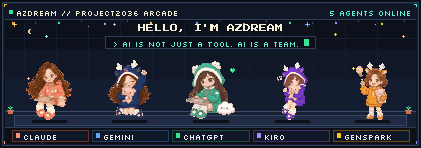
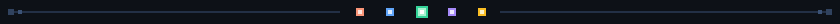
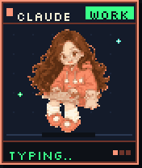
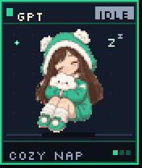
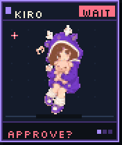
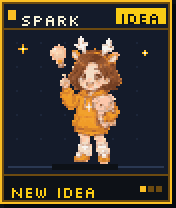
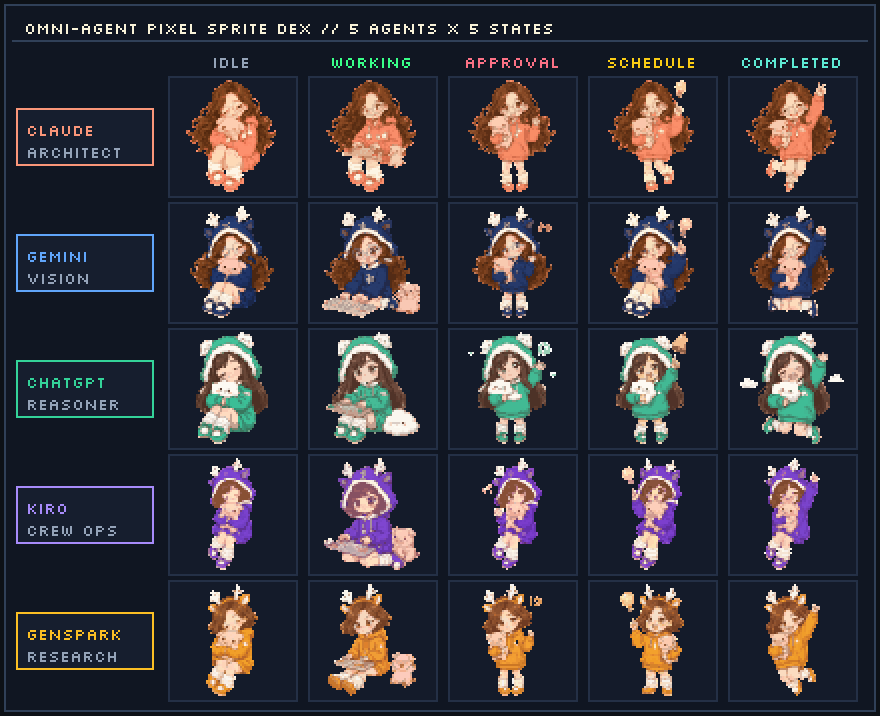
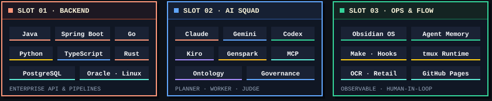
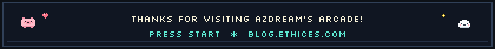

  

    

  
  
  
  

 

  

### 👾 `OMNI-AGENT SQUAD` — *AI is not just a tool. AI is a team.*

  <table>
    <thead>
      <tr>
        <th align="center"><code>01 · ARCHITECT</code></th>
        <th align="center"><code>02 · VISION</code></th>
        <th align="center"><code>03 · REASONER</code></th>
        <th align="center"><code>04 · CREW OPS</code></th>
        <th align="center"><code>05 · RESEARCH</code></th>
      </tr>
    </thead>
    <tbody>
      <tr>
        <td width="166" align="center"></td>
        <td width="166" align="center"></td>
        <td width="166" align="center"></td>
        <td width="166" align="center"></td>
        <td width="166" align="center"></td>
      </tr>
      <tr>
        <td width="166" align="center"><b>Claude</b> Coral · Architect</td>
        <td width="166" align="center"><b>Gemini</b> Sapphire · Vision</td>
        <td width="166" align="center"><b>ChatGPT</b> Mint · Reasoner</td>
        <td width="166" align="center"><b>Kiro</b> Violet · Crew Ops</td>
        <td width="166" align="center"><b>Genspark</b> Amber · Research</td>
      </tr>
    </tbody>
  </table>

  

    
🕹️ <b>Open Sprite Dex (5 Agents × 5 States · 25 Pixel Sprites)</b>

     
    
  

 

  

### 💻 `PLAYER PROFILE`

  

 

### 🎮 `EQUIPPED CARTRIDGES`

  

 

  

### 📜 `QUEST BOARD` — Featured Public Projects

  <table>
    <tbody>
      <tr>
        <td width="420" valign="top">
          <b>🖥️ <a href="https://blog.ethices.com">Project2036 Terminal</a></b> &nbsp;<code>HTML</code> 
          백엔드 자동화 · AI OS 허브 &amp; <a href="https://blog.ethices.com/csi/"><code>/csi/</code> 코스트코 검색</a>
        </td>
        <td width="420" valign="top">
          <b>🛡️ <a href="https://github.com/azdream/ai-agent-gateway">ai-agent-gateway</a> · <a href="https://github.com/azdream/tram-aag">tram-aag</a></b> &nbsp;<code>Go / HTML</code> 
          AI 에이전트 MCP 호출을 검증·관측하는 거버넌스 게이트웨이
        </td>
      </tr>
      <tr>
        <td width="420" valign="top">
          <b>🧠 <a href="https://github.com/azdream/auto-ontology">auto-ontology</a></b> &nbsp;<code>Python</code> 
          에이전트 워크플로우용 시맨틱 그래프 추론 · 컨텍스트 계층
        </td>
        <td width="420" valign="top">
          <b>👾 <a href="https://github.com/azdream/KiroCrew">KiroCrew</a></b> &nbsp;<code>Python</code> 
          세션을 넘어 스스로 개선하며 이어지는 AI 개발 워크스페이스
        </td>
      </tr>
      <tr>
        <td width="420" valign="top">
          <b>⌨️ <a href="https://github.com/azdream/agent-desktop">agent-desktop</a></b> &nbsp;<code>Rust</code> 
          AI 에이전트의 데스크톱 조작 및 자동화를 위한 Computer-Use CLI
        </td>
        <td width="420" valign="top">
          <b>🧩 <a href="https://github.com/azdream/repoprompt-ce">repoprompt-ce</a></b> &nbsp;<code>Swift</code> 
          AI 코딩 에이전트용 macOS 네이티브 컨텍스트 엔지니어링 &amp; MCP CLI
        </td>
      </tr>
    </tbody>
  </table>

 

  

